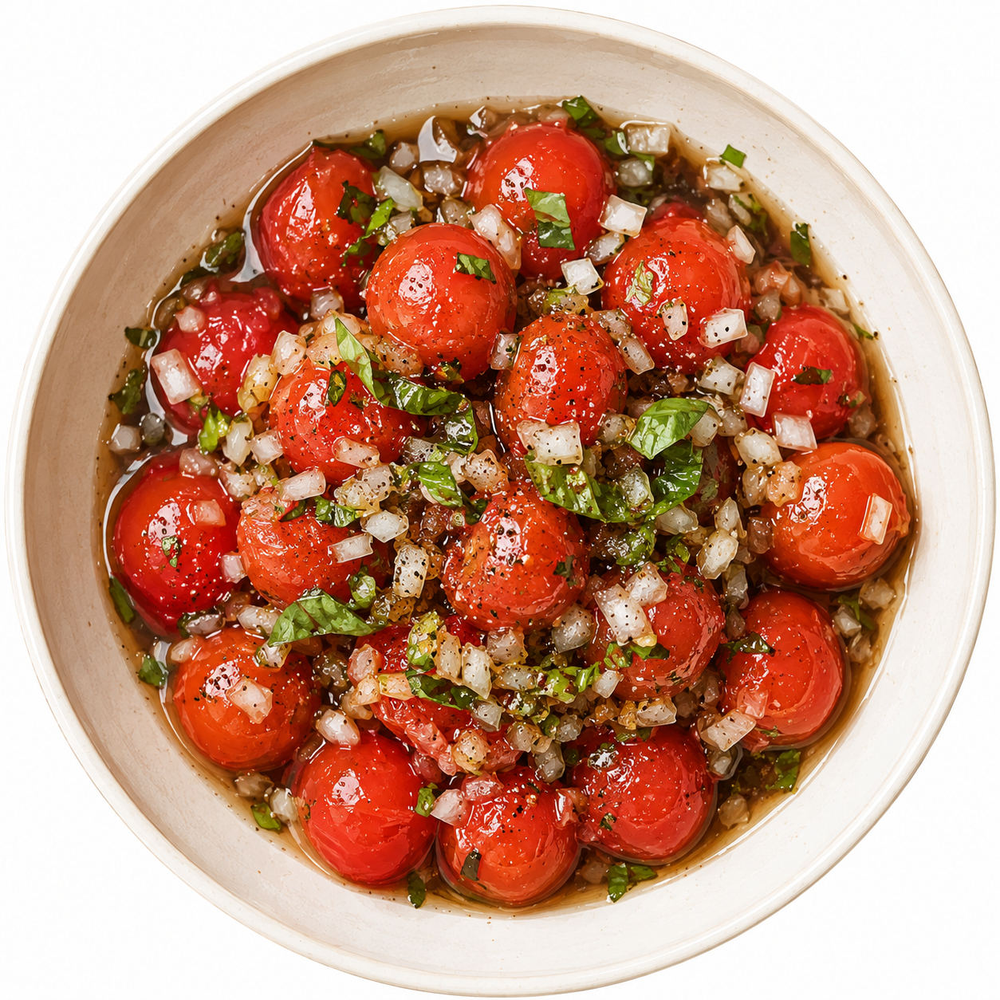
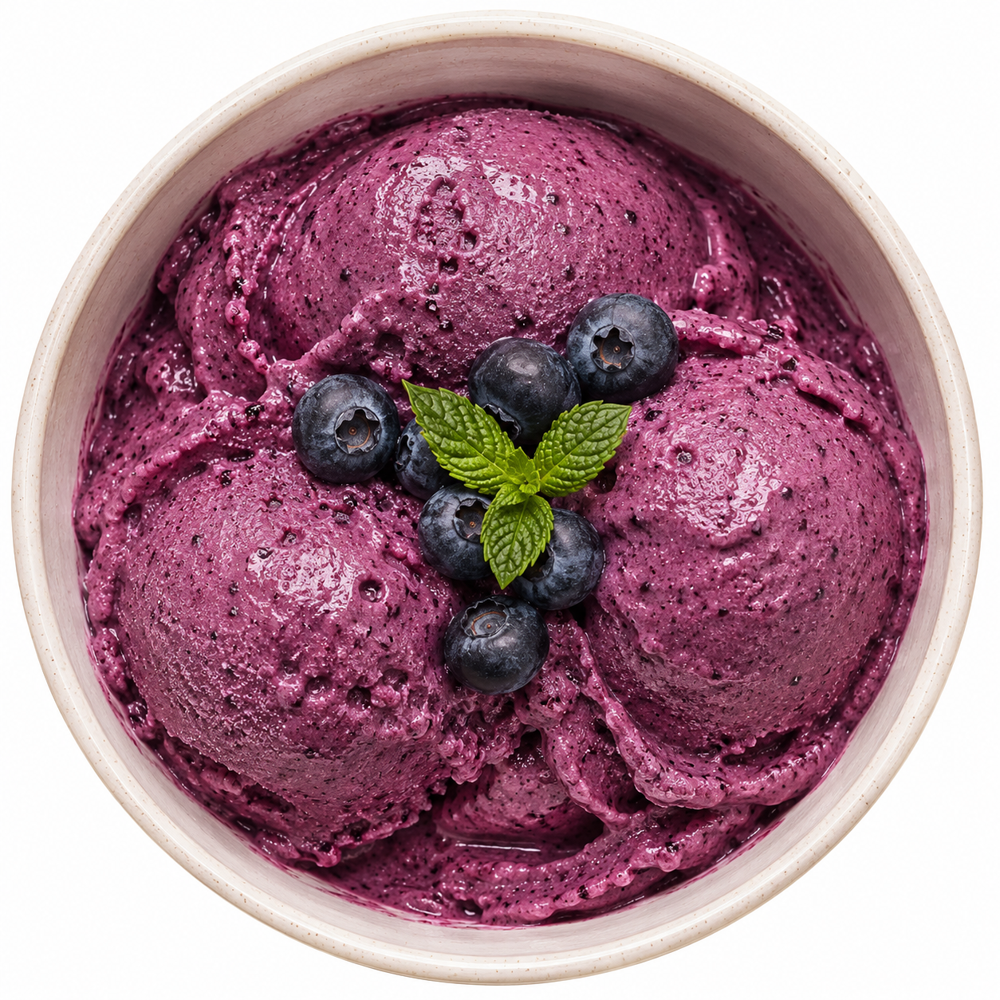
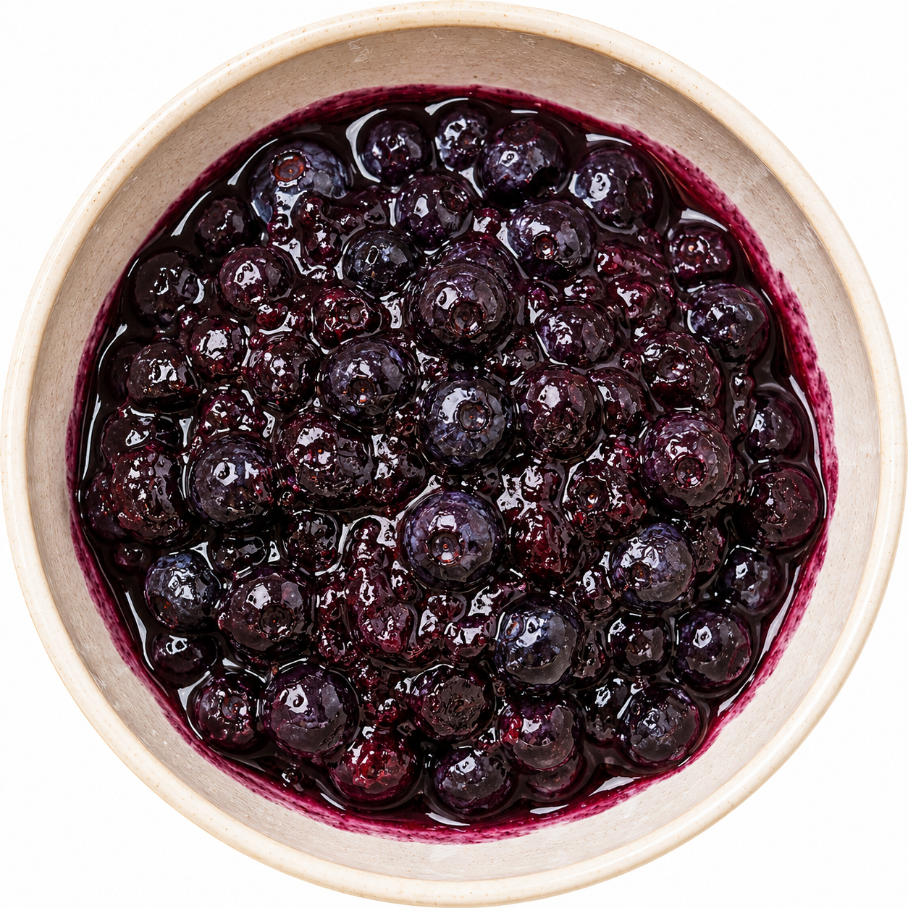
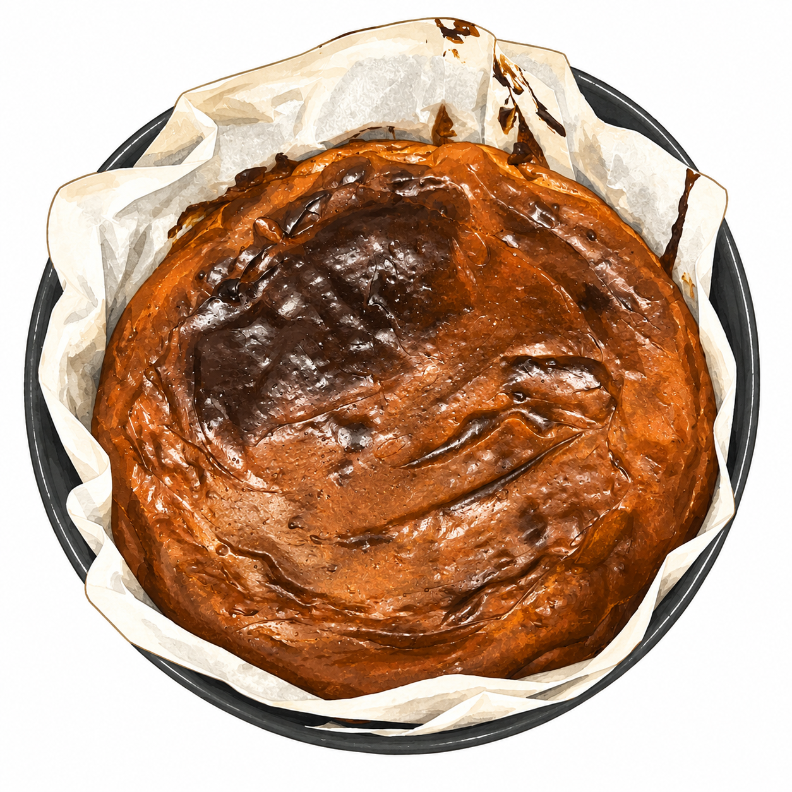

# 식탁과 일상

만들어 먹고, 좋아하는 것들을 기록합니다. 카드 이미지를 누르면 레시피를 볼 수 있어요.

  <a class="recipe-card" href="#/life/recipes/tomato-marinade"><strong>🍅 토마토 마리네이드</strong>차갑게 두고 먹는 산뜻한 토마토</a>
  <a class="recipe-card" href="#/life/recipes/blueberry-sorbet"><strong>🍧 블루베리 셔벗</strong>블루베리와 요구르트 두 가지 재료</a>
  <a class="recipe-card" href="#/life/recipes/blueberry-compote"><strong>🫐 블루베리 콩포트</strong>매실청으로 뭉근하게 끓인 콩포트</a>
  <a class="recipe-card" href="#/life/recipes/basque-cheesecake"><strong>🍰 바스크 치즈 케이크</strong>23cm 원형 팬 기준</a>
  <a class="recipe-card" href="#/life/recipes/basque-cheesecake-yogurt"><strong>🍰 그릭요거트 바스크 치즈 케이크</strong>생크림과 그릭요거트를 넣은 버전</a>
  <a class="recipe-card recipe-card-text" href="#/life/recipes/lasagna-roll">🍝<strong>라자냐롤</strong>시금치 크림소스를 넣어 돌돌 말아 구워요</a>

## 다른 기록

영어 공부나 일상 이야기도 차차 직접 정리해 올릴게요.
